# FlowBlock agent decisions and evidence

The agent's job is to choose a shot from a brief, use compiler feedback to revise that choice, and propose one measured experiment after a take. Its value depends on those decisions helping a creator. Calling a model and recording a trace do not establish that value.

## Where the agent acts

Planning alternates between a model-selected action and an application-produced observation. The next action depends on what the tool returned. That feedback loop makes this an agent workflow rather than a single text-generation request.

```mermaid
flowchart LR
    Brief[Brief and confirmed setup] --> Choice[Model chooses recipe and parameters]
    Choice --> Compile[Application compiles and validates]
    Compile -->|Rejected with evidence| Choice
    Compile -->|Valid candidate| Select[Model selects or abstains]
    Select --> Creator[Creator inspects and films]
    Creator --> Measure[Worker measures the marked product]
    Measure --> Revision[Model reads findings and proposes one change]
    Revision --> Check[Application checks citation and revised geometry]
    Check --> Accept[Creator accepts and tries again]
```

The creator owns room measurements, equipment facts, and acceptance. The compiler owns geometric and approximate framing checks. The video worker owns image-space measurements. The model chooses actions within those boundaries. A model explanation cannot override a rejected path or change the room to make its answer fit.

The deterministic recipe library remains useful on its own. The agent has to justify its additional latency and complexity through better interpretation, repair, and choice. It has not yet beaten the privileged recipe-search reference in the recorded development comparison. That search received structured intent and the checker, so it is also not a matched natural-language competitor. See the [campaign report](../training/experiments/next/results/campaign-report.md).

## What the Agent Lens failures changed

In [conversation 20135b7e](https://forge.coreweave.com/agent-lens/wandb/flowblock/conversations/20135b7e-725f-4cfe-9971-b84eba2a2d4e), the research planner compiled an orbit that crossed the operator boundary, repeated the same compile, then widened its sweep and crossed both operator and camera boundaries. It exhausted its repair budget. The validator correctly rejected those paths. The record does not establish that this particular request had a feasible solution.

The separate [controlled diagnostics](../training/experiments/validation-planner/results/failure-diagnostics.md) found repeated identical rejected compiles on tasks with independently frozen feasible witnesses. They also found returned shots with the wrong family or orbit direction despite valid geometry. Earlier [GPT diagnostics](../training/experiments/next/results/development-gpt-diagnostics.md) found revision-tool calls during planning, before any take existed.

The live product now uses `flowblock-planner-v1.5` and `revision-v1.4`:

| Failure | Implementation response |
| --- | --- |
| Tool selected in the wrong workflow | Planning exposes planning actions only. Revision exposes only `read_take_findings` until the findings have been read. |
| Unsupported or irrelevant parameters | Recipe context lists applicable overrides, defaults, and units. Rejections identify invalid fields. |
| Repeated rejected compile | A key-order-independent fingerprint identifies the repeated action and returns `no_progress` with the earlier rejection. It still consumes the bounded repair allowance. |
| Repair with no relevant feedback | Compile observations include violations, actual movement, height, duration, and parameter guidance. The model is instructed to preserve the requested family and direction. |
| Viewing bearing confused with orbit direction | Tool observations name actual camera-right/left traversal, signed sweep, and start/end bearings. Search suggestions state whether the signed sweep is preserved. |
| Small bearing changes keep colliding | A bounded deterministic bearing search supplies checked alternatives with their viewing-side tradeoffs. The model must choose and compile an alternative before selecting it. |
| Geometry-valid result changes explicit setup | Compiled camera height and duration must match the supplied intent within a tolerance of `1e-6` meters and seconds respectively. Rejected candidates cannot enter final or partial selections. |
| Final rejection lost at budget exhaustion | Every action rejection is recorded before checking whether the repair budget is exhausted. |
| Unchecked declaration that no plan is possible | An empty finish requires a compile check and explicitly limits its conclusion to the candidates examined. A valid candidate may still be discarded for failing the creative brief. |
| Earlier valid work discarded at budget exhaustion | Earlier validated options remain available as an incomplete, unselected result, with an instruction to review them. |
| Citation unrelated to the revised parameter | One finding and one applicable parameter are required. Duration findings support timing changes; spatial findings cannot support timing changes. Movement removal and orbit reversal are rejected. |
| Revision has no supported adjustment | A typed abstention creates no revision. Evidence-specific schemas restrict applicable parameters and size-change direction; repeated rejected proposals return `no_progress`. |
| Revision loses the original brief | Revision context includes the complete saved intent, current motion, applicable overrides, and units alongside the measured findings. |
| Workflow stages appear disconnected | An owned workflow ID groups planning, actual worker attempts, revision, and acceptance in one conversation. Separate stage traces and attempt IDs preserve retries and idle time. |
| Trace obscures the final response or earlier request | Final outputs and outcome attributes are recorded before closing the trace. Every model request receives a separate message snapshot. |

These changes improve the action protocol and the evidence available for repair. Height and duration have explicit fields that application code can check. They do not add a general semantic checker for arbitrary prose. The model can still return a geometrically valid shot with the wrong movement family or direction for a free-text request. Geometry, brief preservation, and creator acceptance need separate judgments.

Revision checks establish a limited relationship between evidence and a proposed experiment. A framing deviation does not reveal the physical cause of the deviation. The server writes the creator-facing explanation from the accepted parameter and cited finding rather than repeating an unverified model explanation.

### Bounded repair search

After a camera or operator collision, the compiler tests bearing offsets of ±15°, ±30°, ±45°, ±60°, ±90°, and ±120° from the rejected candidate's current bearing. It stops after three valid suggestions or twelve compiles. It retains the recipe, scene, gear, intent, and all other overrides. A numeric height or duration mismatch prevents this search.

The search changes the viewing side and world heading. When distance or travel is implicit, the compiler recalculates those values from the new bearing and framing; suggestions expose the resulting radius, travel, sweep, framing, and clearance. Keeping a recipe does not prove that every free-text requirement survives. The model must assess the tradeoff against the brief.

Each suggestion contains source overrides and measured plan properties, without a selectable candidate ID. The model must issue `compile_candidate` for its choice and then `finish` with the returned ID. Unchosen suggestions cannot enter a final or partial agent result. The tool observation records every search trial, its rejection codes, the number of compiles, and elapsed time. This is internal deterministic work, not twelve model-selected actions or evidence that the model found the alternative unaided.

Both coordinators retain six actions, an initial rejected attempt plus two repairs, and a default 30-second cooperative deadline. Planning can therefore perform at most six requested compiles plus thirty-six internal repair-search compiles. These counts exclude the separately labeled recipe-library fallback. The deadline bounds asynchronous work when the process is being scheduled. It cannot guarantee elapsed time through host suspension or a blocked event loop, or cancel computation already running at the provider. The [recorded timing failures](../training/experiments/validation-planner/results/report.md) remain visible.

## What Forge should demonstrate

| Service | Evidence to inspect | Question it answers |
| --- | --- | --- |
| W&B Inference | Model request, response, usage, and model identity | What action did the deployed model choose? |
| Agent Lens | Ordered tool observations, rejected actions, stop reason, and final source | Did the agent adapt to evidence, and why did it stop? |
| Weave evaluations | Per-task outputs, brief and geometry scores, availability, dataset and runtime versions | Did the revised system work across the declared cases? |
| W&B Models and Serverless Training | Dataset lineage, submitted training configuration, optimizer history, and checkpoint | What changed in the trained candidate, and can that change be reproduced? |

A useful demonstration starts with a real rejected move, follows the agent's changed action, then follows a filmed take to a measured finding and an explicitly accepted revision. Comparing another take tests the feedback idea. A successful walkthrough is one case; a fresh evaluation and a creator study are needed to establish broader improvement.

Use [Agent Lens's field guide](agent-lens.md) to separate execution errors from unsuccessful planning. Use [the Forge service map](forge-integration.md) for verified dashboard records. Training should consume reviewed examples of decisions and repairs, with dataset versions kept separate from the held-out evaluation. There is no automatic training on every upload or automatic checkpoint promotion.

The [public-video workflow](public-video-workflow.md) verifies all four stages in one conversation with the default 20B model. It preserves the preceding v1.4 failure, the v1.5 diagnostic, and a remaining default-first instruction miss. The independent public recording and automated acceptance do not measure creator benefit.

The earlier [fresh integration example](fresh-agent-example.md) walks through an executed planning repair, real SAM measurements of synthetic media, and an accepted model revision. It includes the failed attempts and the distinction between same-media replay and a newly filmed take.

## Verification boundary

The current fixes have local regressions covering the recorded orbit sequence, stage-invalid actions, duplicate compiles, terminal rejections, abstention, partial results, explicit height and duration, citation relevance, and trace lifecycle. Repair-search tests cover checked alternatives, retained source facts, selection through a subsequent compile, exclusion of unchosen suggestions, and the combined compile budget. Further regressions cover signed orbit direction, evidence-specific revision schemas, explicit abstention, owned workflow continuity, stale client attribution, lease guards, and remote readback reconciliation. Scripted model replies make these application checks reproducible. They do not measure whether a hosted model now makes better decisions.

The designed v1.3 smoke attempts with [GPT-OSS 20B](https://forge.coreweave.com/agent-lens/wandb/flowblock/conversations/132106f4-da76-4090-97e5-d3a5139ccb0c) and [GPT-OSS 120B](https://forge.coreweave.com/agent-lens/wandb/flowblock/conversations/5a81fb63-d6fe-4947-89ab-70aab488d7cc) both exhausted the repair budget and returned library fallbacks. Their trace readbacks matched the local actions and outcomes. They motivated the later bounded search; they do not establish its effectiveness.

Historical research runtimes, results, and dashboards retain their original versions. A local source snapshot made before the initial fixes lives at `training/artifacts/agent-repair-before-20261030/manifest.json`; both hosted smoke failures also retain their executed source snapshots. The exposed failures are now development material. A new model comparison must freeze new cases, prompts, runtime hashes, scoring, and availability reporting before execution. Each later smoke attempt needs its own outcome and trace readback; a local regression pass is not a successful hosted demonstration.

Creator time to a usable take remains unmeasured. The [prepared creator study](../training/experiments/next/creator-study.md) includes an uncoached repeat so ordinary practice does not get credited to feedback.
