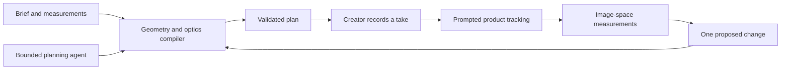

# FlowBlock architecture and reasoning

FlowBlock connects a planned product shot to an observed take and one proposed correction. Its initial user is a solo creator with a stationary product, a measured indoor space, and a phone or small camera. The app provides a testable reference workflow; creator benefit has not been established by a field study.

## What runs where

The Next.js application serves a React editor and a Node API. A pure TypeScript domain engine runs in both the browser and server. Zustand holds current editor state; IndexedDB preserves local drafts, versions, and attempt metadata. PostgreSQL stores owned projects, immutable versions, takes, jobs, revisions, and revocable share snapshots. A Python worker uses FFmpeg and pinned SAM 2.1 Small for actual video analysis.

The application, database, private media, and MPS worker run on the local machine. Optional Forge APIs supply model inference, tracing, and training. No CoreWeave cluster or bucket is required for this setup. Google identity and remote storage remain optional, unvalidated integrations.

## Why the responsibilities are separate

The creator declares scene facts. The language model chooses recipes and parameters. Application code executes allowlisted actions and rejects malformed output. The compiler determines feasibility against the supplied geometry. The worker measures image-space observations. The creator decides whether to accept a proposed experiment.

This separation gives each claim an owner. A persuasive model response cannot make a collision valid. An uncertain mask cannot establish that a product disappeared. A large image of a product cannot prove how far the operator walked. A successful synthetic test cannot establish a useful result for a creator.

Local compilation also keeps editing, validation, playback, and export usable without a network or model response. Uploaded analysis and synchronization need the local services. Generation has an explicitly labeled recipe-library fallback when inference fails.

## Geometry and optics

The compiler builds analytic holds, lines, and arcs from source inputs. Playback traverses moving curves by arc length. Camera position, viewing direction, camera height, product orientation, and operator footprint are separate quantities.

Collision checks use camera and operator discs enlarged by measurement uncertainty and bounded curve approximation error. The entire resulting swept path is tested against room and obstacle boundaries. This follows the configuration-space idea: model the moving body's extent when deciding which positions are free. [LaValle's configuration-space chapter](https://lavalle.pl/planning/ch4.pdf) develops that foundation.

Framing uses a rectilinear pinhole projection of a dimensioned product box. Field of view follows `2 atan(active sensor dimension / (2 × focal length))`. The engine projects the box corners to estimate screen position and extent. This cannot simulate focus, shadows, distortion, or an uncalibrated stabilization crop. The precise conventions and remaining limits live in [the domain guide](../src/domain/README.md).

## Agent and perception

The planning coordinator alternates typed model actions with observations returned by application tools. This is related to the action-and-observation interaction studied in [ReAct](https://arxiv.org/abs/2210.03629). FlowBlock adds fixed action and repair budgets, a wall-clock deadline, source constraints, and a deterministic validator. It does not execute model-generated code.

[SAM 2](https://arxiv.org/abs/2408.00714) provides prompted video segmentation. The creator marks the product, and the worker propagates its mask. Deterministic code derives normalized center, extent, border contact, and duration observations. Time-dependent framing targets accommodate changing product size during a push-in. A separately annotated visibility interval permits intentional hiding; reveal recipes do not plan foreground occlusion.

Tracking quality checks are heuristics. Empty masks, non-finite logits, abrupt changes, or inconsistent corrections can trigger review. Choosing to withhold a finding trades measurement coverage for fewer unsupported claims. [Selective classification](https://arxiv.org/abs/1705.08500) formalizes that tradeoff in a different setting; FlowBlock does not implement its calibrated risk guarantee. Repeated proxy frames are not independent evidence, so findings requiring temporal support count distinct source timestamps.

## Feedback, persistence, and evaluation

The practical loop is plan, observe, propose one change, and try again. One change makes an adjustment easier to understand and compare. It does not prove causality: practice, lighting, operator variation, and tracking coverage can also change the result. The proposed creator study therefore needs an uncoached second attempt and blind assessment of usable footage.

Immutable plan snapshots preserve what was intended for each take. Expected-version checks prevent a stale synchronization from overwriting newer work. Job leases give a worker temporary authority; publication checks that authority again. Idempotency keys prevent duplicate job requests from consuming quota twice. These are explicit state transitions, not an exactly-once delivery claim.

Training is supervised next-action learning from synthetic, solver-selected examples. It is not online reinforcement learning from every upload. The completed candidate produced zero useful matching plans in its small held-out qualification and was not promoted. Historical planner, geometry, fixture generation, and checker sources now execute from an isolated, hash-verified archive; changing the product cannot silently change that experiment. See [training and its recorded limitations](../training/README.md).

The product hypothesis is that corrections tied to a creator's constraints and actual footage can help them reach a usable take sooner. The implementation makes that hypothesis testable. Real creator clips, recipe review, physical-device testing, and a counterbalanced field study are still needed to evaluate it.
