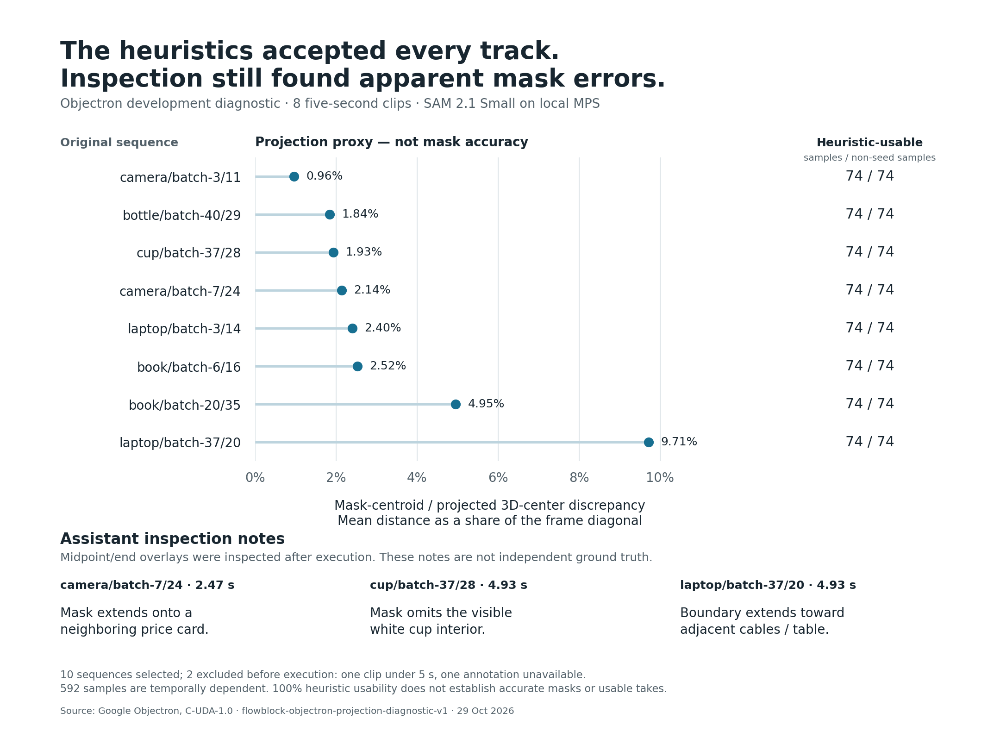

# Objectron diagnostic figure

Every evaluated sample passed the worker's uncertainty heuristics. Assistant inspection nevertheless found apparent mask errors in three sampled views. The figure compares eight source videos; it does not establish tracking accuracy or creator benefit.



Exports: [SVG](objectron-diagnostic.svg), [PDF](objectron-diagnostic.pdf), [CSV](objectron-diagnostic.csv), [source ledger](objectron-diagnostic.provenance.json).

The proxy is the mean Euclidean distance between the mask centroid and the projected 3D-box center, divided by the image diagonal. These are different label definitions even under perfect segmentation. Means use heuristic-usable samples after the first-frame prompt; seed frames are excluded. Percentage values below are rounded for display. The CSV retains full precision.

| Original sequence | Projection discrepancy | Heuristic-usable / evaluated | Processing seconds |
| --- | ---: | ---: | ---: |
| camera/batch-3/11 | 0.9582% | 74 / 74 | 71.49 |
| bottle/batch-40/29 | 1.8424% | 74 / 74 | 79.14 |
| cup/batch-37/28 | 1.9277% | 74 / 74 | 70.96 |
| camera/batch-7/24 | 2.1392% | 74 / 74 | 71.05 |
| laptop/batch-3/14 | 2.3980% | 74 / 74 | 74.09 |
| book/batch-6/16 | 2.5228% | 74 / 74 | 66.49 |
| book/batch-20/35 | 4.9532% | 74 / 74 | 72.03 |
| laptop/batch-37/20 | 9.7112% | 74 / 74 | 70.35 |

Samples within a video are dependent. Processing includes decoding, tracking, measurements and evidence writes, excluding model construction and queueing. No remote GPU execution is implied.

Excluded before execution:

- `bottle/batch-3/14`: source shorter than worker minimum of 5 seconds.
- `cup/batch-16/47`: annotation unavailable.

Assistant inspection notes, preserved from the recorded results:

- `cup/batch-37/28`: Assistant visual inspection at source frame 148, 4.933333s: The predicted mask covers the red exterior but excludes the visible white cup interior. Not independently annotated ground truth.
- `camera/batch-7/24`: Assistant visual inspection at source frame 74, 2.466667s: The predicted mask extends from the camera onto a neighboring price card. Not independently annotated ground truth.
- `laptop/batch-37/20`: Assistant visual inspection at source frame 148, 4.931667s: The predicted boundary extends beyond the laptop body toward cables and the adjacent table. Not independently annotated ground truth.

Source: [Google Objectron](https://github.com/google-research-datasets/Objectron), [C-UDA-1.0](https://github.com/google-research-datasets/Objectron/blob/master/LICENSE). No footage, frames or pixel annotations are included in these exports. The cohort remains development data.

Reproduce from the repository root:

```sh
uv --no-config run --with matplotlib==3.10.7 python training/experiments/next/objectron_figure.py
```
