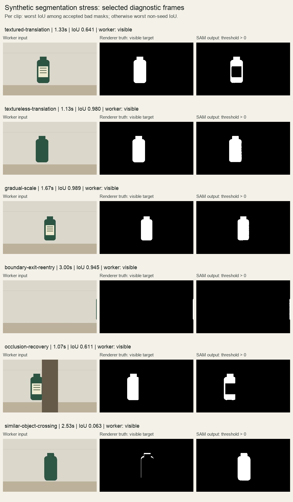

# Synthetic visible-mask stress diagnostic

This is a six-clip development diagnostic using one authored rendered product shape. SAM predictions are compared with visible alpha masks produced by our renderer. It does not measure accuracy on real products or creator benefit.

The unchanged pinned SAM 2.1 Small worker completed all six clips locally on MPS. The first prompt frame is excluded, leaving **444 scored frames**. 26 masks had IoU below the frozen 0.5 threshold; **20 of those were still labeled visible by the worker**. Frames within a clip are correlated observations, not independent trials.

| Case | Mean IoU | Bad masks / 74 | Worker accepted / 74 | Accepted bad masks | Fully hidden truth frames | Processing seconds |
|---|---:|---:|---:|---:|---:|---:|
| textured-translation | 0.673 | 0/74 | 74/74 | 0 | 0 | 70.2 |
| textureless-translation | 0.991 | 0/74 | 74/74 | 0 | 0 | 72.3 |
| gradual-scale | 0.995 | 0/74 | 74/74 | 0 | 0 | 67.9 |
| boundary-exit-reentry | 0.994 | 0/74 | 57/74 | 0 | 15 | 78.3 |
| occlusion-recovery | 0.705 | 0/74 | 67/74 | 0 | 7 | 81.8 |
| similar-object-crossing | 0.521 | 26/74 | 65/74 | 20 | 0 | 78.1 |

IoU is intersection divided by union of predicted and reference target pixels. Both masks empty scores 1; only one empty scores 0. A bad mask is IoU < 0.5. Worker accepted means the existing rules labeled the sample `visible`. Center and extent errors are undefined when either mask is empty; the JSON and CSV preserve those missing values.

Mask overlap and framing usefulness are different. A missing interior label can lower IoU while preserving the outer box. The per-frame data therefore also records center and extent errors; the IoU threshold alone is not a usability judgment.

## Visibility and abstention

- Truth-visible: 422 frames; mean IoU 0.803; 26 bad masks; 411 worker-accepted frames; 20 accepted bad masks; 11 uncertain and 0 missing predictions.
- Fully hidden truth: 22 frames; mean IoU 1.000; 0 bad masks; 0 worker-accepted frames; 0 accepted bad masks; 0 uncertain and 22 missing predictions.

The declared expected-visible interval covers the full clip. Fully hidden frames deliberately test disappearance and recovery; the scorer knows they have empty masks, while the worker does not receive those later labels. This is separate from an authored reveal that intentionally excludes an initial interval from review.

## Selected frames

Selection is deterministic: the lowest-IoU worker-accepted bad frame in each clip, or the lowest-IoU non-seed frame if there is no accepted bad mask. These pictures illustrate errors; the table includes every non-seed frame.

| Case | Selected frame | Seconds | IoU | Worker status |
|---|---:|---:|---:|---|
| textured-translation | 20 | 1.33 | 0.641 | visible |
| textureless-translation | 17 | 1.13 | 0.980 | visible |
| gradual-scale | 25 | 1.67 | 0.989 | visible |
| boundary-exit-reentry | 45 | 3.00 | 0.945 | visible |
| occlusion-recovery | 16 | 1.07 | 0.611 | visible |
| similar-object-crossing | 38 | 2.53 | 0.063 | visible |

## Scope and reproduction

The textured and textureless translation cases share exactly the same truth masks and trajectory. Other cases stress scale, leaving the image, foreground occlusion, and a similar-object crossing. They share one product silhouette and should not be treated as a representative product benchmark.

Only the exact renderer-derived first-frame box reaches SAM. This ideal prompt does not test creator annotation error. The worker's existing `describe_mask` function is observed to retain binary masks; its arguments, result and predictor state are unchanged. All later labels are reserved for grading. Every worker source file, model manifest, fixture, protocol and benchmark script is hashed before inference.

This set is now development data. Tune uncertainty rules against it only with that label; evaluate any change on newly frozen cases and independently annotated real footage before reporting transfer. No runtime thresholds or model parameters were changed for this run.

See [the contract](../research-contract.json), [frozen manifest](frozen-manifest.json), [full summary](summary.json), and [all frame metrics](frame-metrics.csv). Processing time excludes one-time model loading. MPS uses CPU fallback for unsupported operations; CUDA was not tested.
